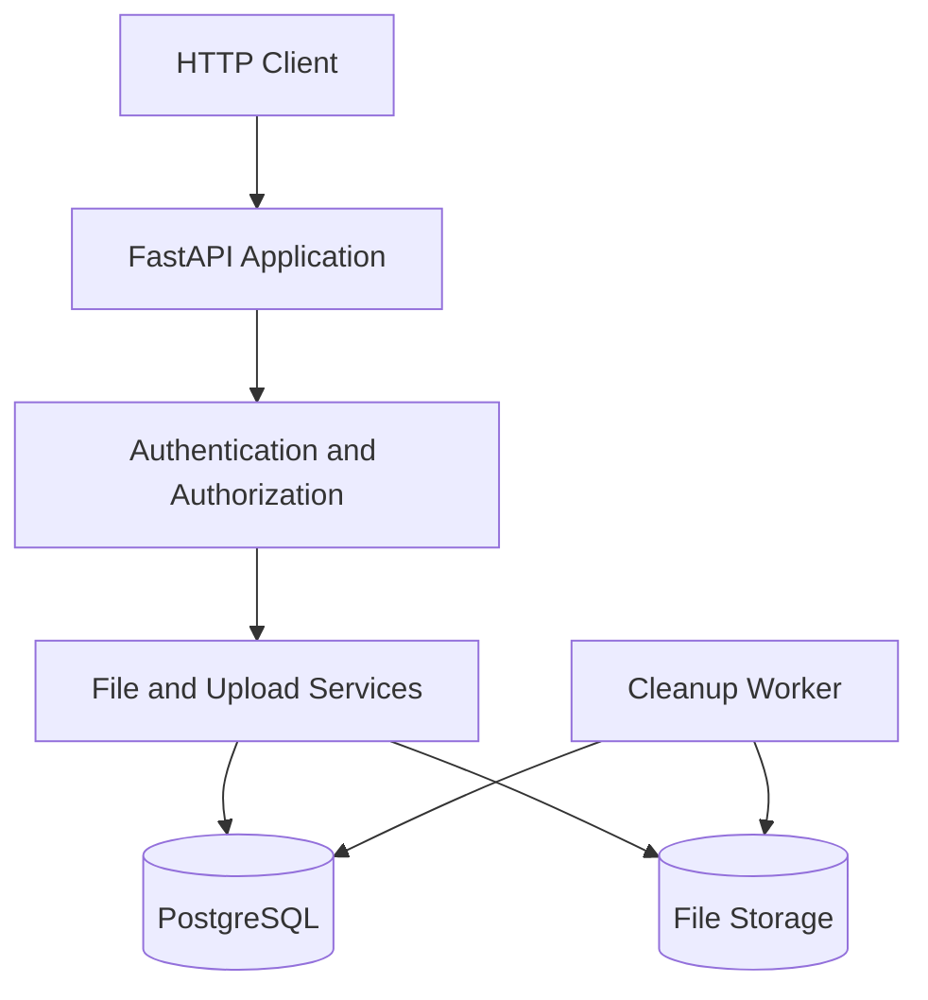

# CloudBox

**A self-hosted personal cloud storage backend built with FastAPI, PostgreSQL, and Docker.**

CloudBox is a backend-focused project exploring the engineering challenges behind a personal file storage service: secure file ownership, storage quotas, resumable uploads, database consistency, and automated background cleanup.

Rather than stopping at basic file CRUD operations, CloudBox explores how uploads can be managed reliably, how storage capacity can be reserved across concurrent operations, and how database state and filesystem storage must work together.

> **Project status:** Backend development milestone. The API, upload workflows, database layer, background cleanup worker, automated tests, and CI pipeline have been developed. A user interface and public demo are planned for a future phase.

## Table of Contents

- [Features](#features)
- [Architecture](#architecture)
- [Technology Stack](#technology-stack)
- [How It Works](#how-it-works)
- [Getting Started](#getting-started)
- [Configuration](#configuration)
- [API Overview](#api-overview)
- [Testing](#testing)
- [Code Quality and CI](#code-quality-and-ci)
- [Project Structure](#project-structure)
- [Engineering Challenges](#engineering-challenges)
- [Current Limitations](#current-limitations)
- [Roadmap](#roadmap)

## Features

### File management

- Upload files through the API.
- List stored files and retrieve file metadata.
- Download previously uploaded files.
- Delete files and update storage accounting.
- Calculate SHA-256 checksums for uploaded files.
- Associate file records with their owners.

### Authentication and access control

- Password-based authentication using Argon2 password hashing.
- Token-based authentication using JWT.
- Authenticated endpoints for accessing user-specific resources.
- Ownership checks to prevent users from accessing other users' files.

### Storage management

- Configurable maximum upload size.
- Per-user storage quotas.
- Storage reservations for in-progress uploads.
- Database-backed tracking of used and reserved storage.
- Transactional updates to keep storage accounting consistent.

### Resumable uploads

CloudBox implements a chunk-based upload workflow so a file does not need to be transferred as one uninterrupted request.

- Create an upload session.
- Transfer file chunks independently.
- Retrieve the status of an upload session.
- Complete an upload once the required chunks have been received.
- Track upload expiration and reserved storage.

Implemented resumable upload endpoints:

| Method | Endpoint | Purpose |
|---|---|---|
| `POST` | `/uploads` | Create an upload session |
| `PUT` | `/uploads/{upload_id}/chunks/{chunk_index}` | Upload a chunk |
| `GET` | `/uploads/{upload_id}` | Retrieve upload status |
| `POST` | `/uploads/{upload_id}/complete` | Complete an upload |

### Background cleanup

A separate cleanup worker periodically searches for expired, unfinished upload sessions.

It removes associated temporary upload data and releases the storage reservations held by expired sessions. Running cleanup separately from the API keeps this maintenance task independent of normal request handling.

### Automated testing

- Pytest-based automated tests.
- HTTP-level API tests using HTTPX.
- A separate test database and test storage directory.
- Alembic database migrations.
- Continuous integration through GitHub Actions.

## Architecture

CloudBox separates the HTTP API, persistent metadata, physical file storage, and background maintenance.



### Components

**FastAPI application**

Exposes HTTP endpoints for authentication, file management, and resumable uploads.

**PostgreSQL**

Stores users, file metadata, upload sessions, and storage accounting information.

**Filesystem storage**

Stores uploaded files and temporary upload data separately from their database metadata.

**Cleanup worker**

Periodically removes expired upload sessions and their temporary data.

**Alembic**

Manages versioned database schema migrations.

**Docker Compose**

Coordinates the application's containers and supporting services for local development.

## Technology Stack

| Technology | Purpose |
|---|---|
| Python 3.14 | Application language |
| FastAPI | HTTP API |
| SQLAlchemy | Database ORM |
| PostgreSQL 16 | Persistent metadata and transactional storage accounting |
| Alembic | Database migrations |
| Argon2 | Password hashing |
| JWT | Authentication tokens |
| Docker and Docker Compose | Containerized development environment |
| Pytest | Automated testing |
| HTTPX | HTTP-level testing and benchmarking |
| Ruff | Python linting and formatting |
| GitHub Actions | Continuous integration |

## How It Works

### 1. File uploads

A file upload involves both a physical file and a database record.

The database stores metadata such as the filename, file size, MIME type, checksum, owner, creation timestamp, and storage path. The physical file is stored separately.

This separation allows the API to expose structured metadata without treating the database itself as file storage.

### 2. Storage quota accounting

A storage quota must account for more than files that have already finished uploading.

Consider a user with 100 MB of available storage who starts two uploads simultaneously. If both requests check only the already-used storage, both could believe there is enough capacity.

CloudBox addresses this by tracking reserved storage as well as used storage.

The intended invariant is:

`storage_used + reserved_storage <= max_storage_per_user`

Reservations are made through a conditional database update, allowing PostgreSQL to enforce the capacity check atomically.

When an upload is completed, cancelled, or expired, the relevant reservation must be converted into used storage or released as appropriate.

### 3. Resumable uploads

The resumable upload workflow separates session creation from chunk transfer and finalization.

An upload session records information such as its owner, total size, chunk size, total number of chunks, status, and expiration time.

This makes upload progress explicit and provides a foundation for handling interrupted transfers without restarting the entire upload.

### 4. Expired upload cleanup

Incomplete uploads can otherwise leave temporary files and reserved storage behind.

The cleanup worker periodically identifies expired sessions and removes their associated temporary data while releasing their storage reservations.

This introduces an important consistency challenge: the database and filesystem must remain aligned even when operations fail partway through.

## Getting Started

### Prerequisites

Install the following:

- Git
- Docker
- Docker Compose
- Python 3.14, if running Python tools locally outside Docker

### 1. Clone the repository

```bash
git clone <YOUR_REPOSITORY_URL>
cd cloudbox
```

Replace the placeholder with your actual Git repository URL.

### 2. Configure environment variables

Create a local `.env` file using the variables described in the [Configuration](#configuration) section.

Use local development credentials and a unique, randomly generated JWT secret. Do not commit `.env` or production secrets to version control.

### 3. Start the application

```bash
docker compose up --build -d
```

Inspect the running services:

```bash
docker compose ps
```

View application logs:

```bash
docker compose logs -f api
```

View cleanup worker logs:

```bash
docker compose logs -f cleanup-worker
```

### 4. Apply database migrations

If migrations are not automatically applied by the configured startup process, run them using the API container:

```bash
docker compose exec api alembic upgrade head
```

If the API container exits before migrations can run, use the repository's configured one-off container workflow instead.

### 5. Explore the API

When the API is running locally, visit:

- Swagger UI: `http://localhost:8000/docs`
- OpenAPI schema: `http://localhost:8000/openapi.json`

These URLs assume the API is exposed on port `8000`, as configured in the local Docker Compose setup.

## Configuration

CloudBox uses environment-based configuration to separate application settings from source code.

| Variable | Purpose |
|---|---|
| `DATABASE_URL` | SQLAlchemy connection URL for PostgreSQL |
| `STORAGE_DIR` | Directory used for file storage |
| `MAX_UPLOAD_SIZE` | Maximum permitted upload size in bytes |
| `MAX_STORAGE_PER_USER` | Per-user storage quota in bytes |
| `JWT_SECRET_KEY` | Secret used to sign JWT tokens |
| `JWT_ALGORITHM` | JWT signing algorithm |
| `JWT_ACCESS_TOKEN_EXPIRE_MINUTES` | Access-token lifetime in minutes |
| `CLEANUP_INTERVAL_SECONDS` | Time between cleanup worker cycles |

Check `app/config.py` and the cleanup worker for the exact environment variable names supported by the current version. The table uses the intended configuration names; confirm that they match the application's settings before relying on them.

For local development, use a separate test database and test storage directory. Never point the test suite at a database containing important data.

## API Overview

CloudBox provides endpoints for authentication, file management, and resumable uploads.

| Area | Operations |
|---|---|
| Authentication | Register, log in, retrieve the authenticated user |
| File management | Upload, list, download, delete |
| Resumable uploads | Create sessions, upload chunks, inspect status, complete sessions |

The exact authentication and file-management paths can be explored through the generated OpenAPI documentation at `/docs`.

All file operations should enforce authentication and ownership checks. Clients should not be allowed to choose arbitrary server filesystem paths.

## Testing

Run the test suite in your development environment:

```bash
pytest -v
```

Before running tests, ensure that the test database has the current Alembic migrations applied and that test configuration points to the dedicated test database and storage directory.

The suite exercises API behavior, including file operations, authentication, upload workflows, and storage-related functionality as covered by the current tests.

Tests should never be run against production data.

## Code Quality and CI

CloudBox uses Ruff to enforce consistent Python code style and catch common programming errors.

Run the linter:

```bash
ruff check .
```

Check formatting:

```bash
ruff format --check .
```

Apply formatting:

```bash
ruff format .
```

Apply supported automatic lint fixes:

```bash
ruff check . --fix
```

Run tests:

```bash
pytest -v
```

GitHub Actions runs the project's configured automated checks on pushes and pull requests. The workflow uses PostgreSQL as a service so tests can run against a real database engine rather than relying on a mocked database.

## Project Structure

```text
cloudbox/
├── app/
│   ├── main.py
│   ├── config.py
│   ├── database.py
│   ├── models.py
│   ├── routes.py
│   ├── security.py
│   ├── services/
│   │   └── files.py
│   └── workers/
│       └── cleanup.py
├── alembic/
│   └── versions/
├── scripts/
│   └── benchmark_concurrent_uploads.py
├── tests/
├── storage/
├── docker-compose.yml
├── requirements.txt
├── alembic.ini
└── README.md
```

This is a representative layout. Keep the final tree synchronized with the actual repository, especially if some modules have been renamed or additional configuration files have been added.

## Engineering Challenges

CloudBox explores several backend engineering concerns beyond basic CRUD operations:

- **Concurrency:** preventing concurrent upload requests from exceeding storage quotas.
- **Consistency:** coordinating database records with files on disk.
- **Resource management:** reserving and releasing storage for incomplete uploads.
- **Lifecycle management:** expiring upload sessions and cleaning up temporary data.
- **Security:** password hashing, token-based authentication, and per-user resource authorization.
- **Maintainability:** schema migrations, automated tests, linting, and CI.

These are the areas where the project can evolve from a functional API into a more robust storage service.

## Current Limitations

CloudBox is currently a backend development project rather than a finished consumer product.

- No dedicated user interface yet.
- No public demo deployment yet.
- Local filesystem storage is used rather than distributed object storage.
- Production deployment, operational monitoring, and recovery procedures require further work.
- Performance characteristics should be measured under controlled workloads before making scalability claims.

## Roadmap

### Completed development milestones

- [x] FastAPI application and PostgreSQL integration
- [x] Database models and Alembic migrations
- [x] File upload, listing, download, and deletion
- [x] Authentication and file ownership
- [x] Storage quota accounting and reservations
- [x] Resumable upload sessions and chunk endpoints
- [x] Background cleanup worker
- [x] Automated tests and GitHub Actions CI
- [x] Ruff linting and formatting workflow

### Future work

- [ ] Build a polished web interface for file management.
- [ ] Add a safe, publicly accessible demo.
- [ ] Improve operational observability and production deployment.
- [ ] Expand concurrency and failure-recovery testing.
- [ ] Publish reproducible performance benchmark results.
- [ ] Evaluate object storage and other deployment options.

## Motivation

CloudBox is an opportunity to explore the less visible engineering behind a storage service: transactions, concurrent operations, resource limits, authentication, interrupted uploads, and background maintenance.

The project is intended as a learning and portfolio project focused on backend engineering, systems design, and reliable infrastructure.

